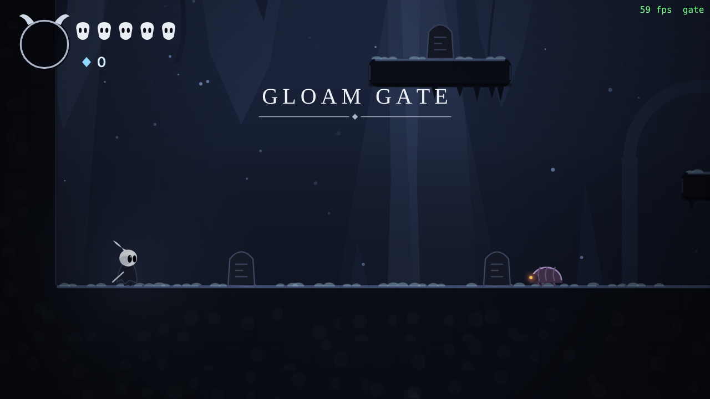
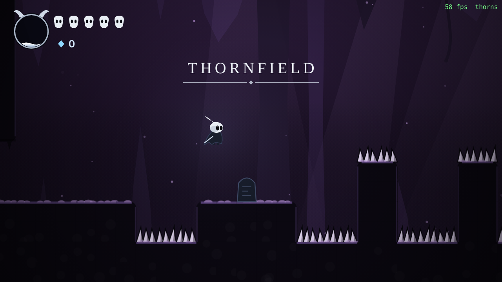
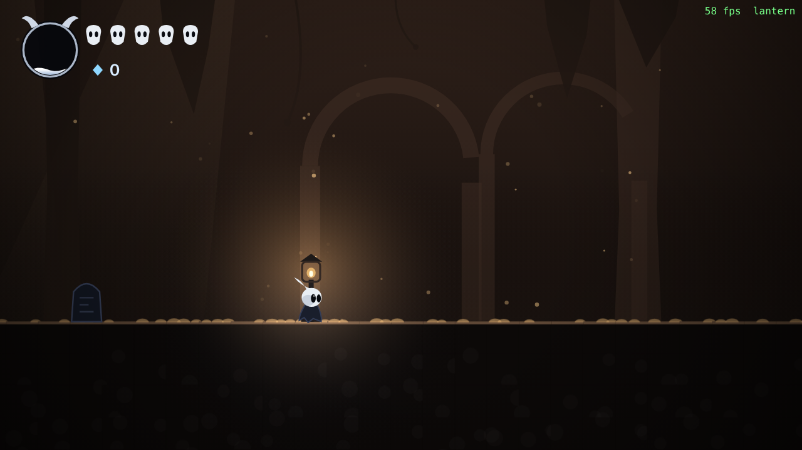
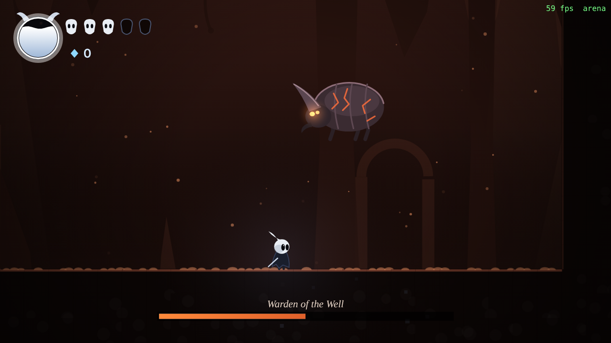
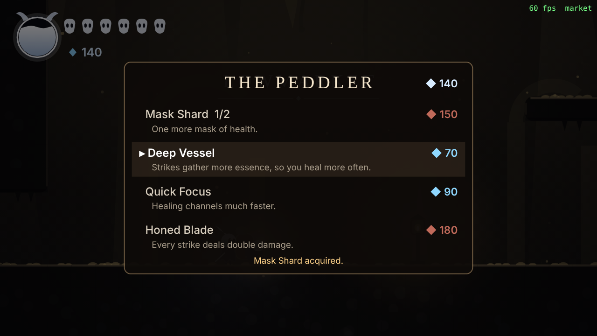
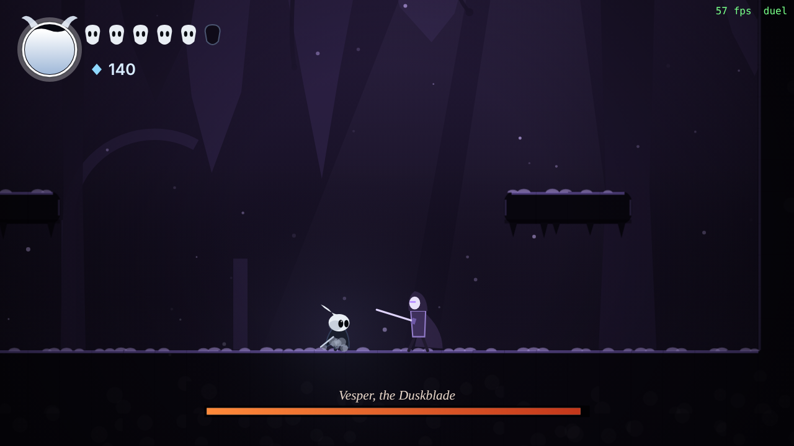

# Gloamwell

An original 2D action-platformer, built to recreate the *game feel* of Hollow Knight: tight movement, nail-style combat with pogo bounces, lantern save points, a death echo, ability gates, a merchant, and two bosses with distinct fighting personalities. All names, art, sound and lore are original. Nothing is taken from Team Cherry's game.

It runs in any modern browser, so it plays on a Mac in Safari or Chrome. Everything (characters, terrain, effects, sound) is generated in code. There are no image or audio files.

| | |
|---|---|
|  |  |
|  |  |
|  |  |

## Run it

```sh
npm install
npm run dev        # http://localhost:5173
```

```sh
npm run build      # strict typecheck + production bundle in dist/
npm run preview    # serve the production build
npm test           # 97 unit and simulation tests
npm run e2e        # headless playthrough with screenshots (see Testing)
```

Requires Node 18+.

## Controls

| Action | Keyboard | Gamepad |
|---|---|---|
| Move | Arrows / WASD | Left stick / D-pad |
| Jump (hold for height) | Z / Space / J | A |
| Strike | X / K | X |
| Aim strike | hold Up or Down | hold Up or Down |
| Dash (once found) | C / L / Shift | RB / RT |
| Heal (hold) | V / I | B |
| Rest at a lantern | Up | Up |
| Pause | Esc / P | Start |
| Mute | M | |

Heal is on **V / I**, not A: A is "left" in WASD, so it can't also be heal.

## What's in the game

Fifteen connected rooms in two areas, roughly 20-30 minutes for a first run.

**The Well** (first area): Gloam Gate → Rootway → The Long Throat (wall-jump climb) → Thornfield (pogo gauntlet) → Shrine of Gales (**dash**) → Lantern Rest (lantern + merchant) → The Sundered Floor (dash gate) → The Well Floor (**boss: Warden of the Well**).

**The Lowmarket** (behind a seal that breaks when the Warden falls): The Ember Stair → Lowmarket (hub: lantern + merchant) → The Needle Spires → Featherfall Nest (**double jump**) → back to Lowmarket and up The Long Ascent (double-jump climb) → Vesper's Court (**boss: Vesper, the Duskblade**). A secret room, Hoarder's Hollow, sits above the Spires and needs the double jump.

### Shards and the Peddler

Shards drop from every enemy (bosses drop a lot) and from a secret hoard. Spend them at the Peddler, who is at Lantern Rest and in the Lowmarket. Press **Up** next to him.

| Upgrade | Effect | Cost |
|---|---|---|
| Mask Shard (×2) | +1 max mask each | 60, then 150 |
| Deep Vessel | 16 essence per hit instead of 11, so you heal more often | 70 |
| Quick Focus | Healing channels in 0.55 s instead of 0.95 s | 90 |
| Honed Blade | Strikes deal double damage | 180 |

Upgrades are saved. Dying drops your unspent shards as an echo, so there's a real choice between spending now and carrying them into danger.

### How the enemies think

Every enemy has a temperament, so the same tactic doesn't work everywhere:

- **Skitter**: each one is bold or timid. Bold ones rush you when you're level with them and turn on you when hurt. Timid ones scurry away.
- **Duskmoth**: perches above you, aims where you're *going*, and about a third of the time loses its nerve mid-tell, darts aside, and tries again.
- **Ironshell**: its shield blocks strikes from the front. It learns: every hit in the back makes it turn faster. Crowd it and it bashes you, cooldown or not; hammer its shield and it may counter-bash.
- **Spitter**: lobs acid that leads your movement. Get close and it shells up, shrugging off side strikes (hit it from above), then pops open and spits point-blank.

### The bosses

**Warden of the Well**: a slow brute that holds grudges.
- Its tells vary in length every attack, so you can't fight it on rhythm.
- Four quick hits and it *shrugs* you off with a shockwave slam, which punishes greedy combos.
- Camp on its back pogoing and it *bucks*, flinging embers straight up.
- Try to heal at range and it charges you.
- After slamming into a wall it sometimes roars in frustration: a free opening.
- Phase two (half health): faster, adds falling debris, chains landings into charges, and some charge tells turn into leaps.
- It cycles its whole moveset in shuffled order, so every move shows up and none repeats back to back.

**Vesper, the Duskblade**: a proud duelist who studies you.
- She keeps her distance, backstepping as you close in.
- She tracks your habits. Keep swinging into her guard and her parry chance climbs (up to 60%, or 75% enraged). A parry staggers you and she ripostes. Pogo too much and she answers with a rising cut.
- Three quick hits and she backflips away and counters from range.
- She feints lunges, punishes healing, and taunts you if you hang back (a gamble: hitting her during the taunt provokes an instant backflip).
- Phase two: double-back lunges, longer combos, and thrown dusk crescents.

### Core mechanics

- **Movement:** acceleration and deceleration, instant ground turnaround, variable jump height, coyote time (100 ms), jump buffering (100 ms), capped fall speed, wall cling, slide and wall jump, and an unlockable dash that refreshes on landing, clinging or bouncing.
- **Combat:** side, up and down strikes. A down strike in the air pogos off enemies and thorns. Every hit has hitstop, screen shake, sparks and knockback on both sides. Hits fill an essence meter. Hold heal to spend 33 essence on one mask (a slow channel that breaks if you're hit or let go).
- **Damage:** 5 masks, 1.3 s of invulnerability with flicker, knockback. Thorns and black water always hurt and return you to the last safe ground.
- **Death:** your shards stay behind as an *echo* where you last stood safely. You wake at the last lantern. Reach the echo to take them back.
- **Double jump** (Twin Feather): one extra jump in the air, refreshed on landing, clinging or bouncing.
- **Saving:** lantern, abilities, bosses, upgrades, the hoard, shards and echo are saved to `localStorage`. If storage is blocked (private browsing), the game still runs; it just doesn't persist.

## Architecture

```
src/
  core/       fixed-timestep loop, input (keyboard + gamepad, press latching),
              camera, seeded RNG, WebAudio synth, tuning constants
  physics/    tile map and swept AABB collision with sub-stepping
  entities/   player state machine, enemies, boss, projectiles, pickups
  world/      room data (ASCII), room parser, World (rules and combat), save, particles
  render/     chunk-cached terrain, parallax background, procedural sprites
  ui/         HUD, title / pause / controls screens
  game.ts     scene flow (title, play, pause)
  main.ts     browser bootstrap
```

- **The simulation has no DOM dependency.** `World` runs headless, which is what lets the tests drive real gameplay with scripted input.
- **Fixed 60 Hz simulation, decoupled from rendering.** Rendering interpolates positions, so it stays smooth on 120 Hz ProMotion displays.
- **Input presses are latched between steps,** so a tap shorter than one frame is never lost. Presses during hitstop are buffered, not dropped.
- **Collision moves X then Y in sub-steps of at most 8 px,** so nothing tunnels, at any speed.
- **Every feel-related number lives in `src/core/tuning.ts`.**
- **Rooms are ASCII grids in `src/world/rooms.ts`.** Border digits are doors, and a door connects to the door with the same digit in the linked room.

## Testing

`npm test` runs the Vitest suite:

- **Collision:** landing flush, walls, ceilings, and no tunnelling through a one-tile wall at any speed (including a real dash).
- **Movement windows:** coyote time accepts a late jump and rejects one that is too late. The jump buffer remembers an early press and forgets one that is too early. Tap vs hold jump height.
- **Combat:** pogo off thorns and off an enemy, damage plus invulnerability, hazard respawn, heal success and heal cancellation, wall cling and wall jump.
- **Save:** round-trip, corrupt or missing data, storage that throws, booting a world from a save.
- **Death:** shards become an echo, you wake at the lantern, touching the echo returns them.
- **Shop:** prices, levels, sold-out and too-poor cases, stats applied, persistence, and the Up → buy → leave flow.
- **Personalities:** the Warden shrugs off a 4-hit combo and bucks a pogo-camper; Ironshells turn faster after back hits; skitters split into bold and timid.
- **Level design proofs, by bot:**
  - Every door in every room is walked through, and the player arrives standing, unhurt, inside the right room.
  - A bot tries every takeoff timing at the dash gate. Without the dash none succeed; with it, many do.
  - A bot pogo-chains across Thornfield without the dash.
  - A bot wall-jumps up the shaft's chimney.
  - The seal really blocks the east until the Warden falls.
  - The Lowmarket's high ledge and the Spires secret can't be reached without the double jump; with it, a bot climbs all of The Long Ascent.
  - A bot crosses the Needle Spires pillar to pillar without the double jump and without taking damage.
  - Both boss fights run to completion on three seeds each, with no state lasting long enough to look stuck, the gates reopening, and the victory saved. The Warden is seen using every attack. Against a bot that keeps swinging at her face, Vesper is seen parrying it and backflipping out of its combos.

`npm run e2e` starts the dev server, opens Chromium with Playwright, and plays: starts a new game, walks and fights through the first room into the second **using real key presses**, rests at the lantern, takes the dash relic, jumps and dashes across the chasm, fights the Warden into phase two, then continues into the second area: buys a Mask Shard from the Peddler, takes the Twin Feather, measures the double jump, and fights Vesper. It saves screenshots to `screenshots/` and fails on any console error or failed check. It needs Playwright, which is deliberately not a dependency (it downloads a browser):

```sh
npm i -D playwright && npx playwright install chromium
npm run e2e
```

URL flags: `?debug` shows FPS and exposes `window.__gloam` (warp between rooms, unlock dash), which the e2e script uses. `?hitboxes` draws collision boxes.

## Known limitations

Being straight about what this is and isn't:

- **It's still small.** Fifteen rooms, four enemy types, two bosses, two abilities, four upgrades. No map, charm system, dialogue, or music score.
- **The art is programmer art.** It's moody and readable, but procedural vector shapes are nowhere near hand-drawn quality. This is the biggest gap between this and the game it's inspired by.
- **The feel numbers were tuned by reasoning and bots, not by people.** Bots can prove the windows exist and that each room is beatable. They can't tell you whether the jump feels floaty. This needs human playtesting, and `src/core/tuning.ts` is where to adjust.
- **Both boss fights are only proven completable with a god-mode bot.** They haven't been balanced against a real player. Vesper's parry odds and the Warden's grudge thresholds are guesses that need playtesting.
- **Prices are set from shard income on paper, not from real play.** If the economy feels stingy or generous, change `src/world/shop.ts`.
- **Gamepad support follows the W3C Standard Gamepad layout but was never tested on a physical controller.**
- **Verified only in headless Chromium.** Safari should work (it needs Safari 16+ for `roundRect`) but wasn't run.
- **It's a web page, not a Mac `.app`.** To ship it as a native app, wrap `dist/` with Tauri or Electron.
- **Rooms respawn their enemies every time you enter,** so shards can be farmed, which makes the shop grindable.
- **No key rebinding, volume slider or fullscreen toggle** (use the browser's fullscreen). On 16:10 screens the view is letterboxed.
- **The synthesized sound effects are functional rather than characterful.**
